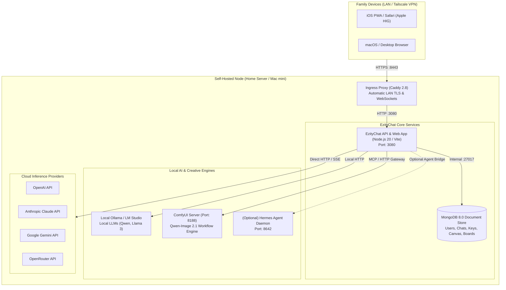

# Ezity AI — Private Family Platform Architecture Specification

**Document Version:** 1.0.0  
**Date:** November 9, 2026  
**Status:** Approved Architecture Blueprint  
**Target Product:** Ezity AI (Private, Self-Hosted Multi-User Personal AI Platform for Family Use)  
**Foundation Base:** `EzityChat` (LibreChat `v0.8.9-rc1` fork) + Selected Assets from `hermes-mobile`  
**Working Directory:** `/Volumes/En.Sol-SSD/WebProject`

---

## 1. System Vision & Product Boundary

Ezity AI is a **private, self-hosted multi-user personal AI platform** designed specifically for the product owner's family (approximately 3 to 6 family members). It is explicitly **not a commercial SaaS product**.

```
┌────────────────────────────────────────────────────────────────────────┐
│                        EZITY AI PRODUCT BOUNDARY                       │
├───────────────────────────────────┬────────────────────────────────────┤
│           IN SCOPE (FAMILY)       │      OUT OF SCOPE (COMMERCIAL)     │
├───────────────────────────────────┼────────────────────────────────────┤
│ • Independent family accounts     │ • Stripe / billing / subscriptions │
│ • Private chats, files & memories │ • Public self-registration         │
│ • Multi-provider (Cloud & Ollama) │ • Organization / tenant billing    │
│ • Ezity companion personality     │ • Complex multi-region cloud infra │
│ • Canvas Workspace & diff review  │ • Anonymized telemetry & analytics │
│ • Interactive Visual Mindmap Board│ • Enterprise SAML / SCIM directory │
│ • ComfyUI Qwen-Image generation   │ • Complex KYC / legal compliance   │
│ • Future optional Hermes backend  │                                    │
└───────────────────────────────────┴────────────────────────────────────┘
```

---

## 2. System Context & Container Topology

To balance operational simplicity with robust multi-user concurrency and security, Ezity AI utilizes a streamlined, low-maintenance 3-container topology:



### Container Services Breakdown
1. **`ezity-core` (EzityChat / LibreChat):** Single container packaging the Node.js Express backend and prebuilt Vite React frontend. Handles authentication, conversation state, provider routing, Canvas APIs, and memory management.
2. **`ezity-db` (MongoDB 8.0):** Lightweight container providing non-blocking asynchronous document persistence for users, conversations, encrypted credentials, Canvas documents, and boards. Consumes ~250MB RAM for family workloads.
3. **`ezity-ingress` (Caddy):** Handles TLS termination with internal certificates for LAN and mobile PWA access, WebSocket upgrades, and secure cookie forwarding. Consumes <30MB RAM.

*(Note: Meilisearch, pgvector, and Python RAG API are omitted from default family deployment to minimize RAM consumption, saving ~2.5GB RAM. Basic keyword search and file uploads operate natively).*

---

## 3. Multi-User Authentication & Account Lifecycle

### 3.1 Closed Family Registration Model
- **Public Registration:** Disabled (`ALLOW_REGISTRATION=false`).
- **Account Creation:** The product owner (Admin) generates single-use invite links or creates accounts directly via the administrative CLI:
  ```bash
  # Admin CLI commands provided by LibreChat:
  npm run create-user
  npm run invite-user
  ```
- **Authentication Strategies:**
  - **Local Username / Password:** Bcrypt-hashed credentials stored in MongoDB.
  - **Optional Social Login:** Google OAuth2 for frictionless family login (`PASSPORT_GOOGLE=true`).
  - **Session Management:** Secure HttpOnly, SameSite cookies with SHA-256 session token hashing.
- **Two-Factor Authentication (2FA):** Supported out-of-the-box for adult family members via TOTP authenticator apps.

---

## 4. Per-User Authorization & Data Isolation Architecture

To guarantee zero cross-user data leakage, every subsystem adheres to strict tenant isolation:

```
┌────────────────────────────────────────────────────────────────────────┐
│                      DATA ISOLATION GUARANTEES                         │
├───────────────────┬────────────────────────────────────────────────────┤
│ Asset Domain      │ Enforcement Mechanism                              │
├───────────────────┼────────────────────────────────────────────────────┤
│ Conversations     │ `Conversation` schema enforced by `user: req.user.id`│
│ Messages          │ `Message` schema enforced by `user: req.user.id`   │
│ Provider Keys     │ Encrypted at rest via AES-256 (`Key` collection)   │
│ Personal Memory   │ `MemoryEntry` schema indexed by `{ userId, key }`  │
│ Canvas Documents  │ `CanvasDocument` schema checked via `userId` filter │
│ Visual Boards     │ `CanvasBoard` schema checked via `userId` filter   │
│ Files & Uploads   │ Path-scoped `/uploads/${userId}/${fileId}`         │
│ Shared Links      │ Explicit cryptographic share tokens via `Share` DB │
└───────────────────┴────────────────────────────────────────────────────┘
```

1. **Database Queries:** All Mongoose models enforce explicit user scoping. Route handlers reject requests where `doc.user.toString() !== req.user.id` with `403 Forbidden`.
2. **File & Blob Storage:** User uploads and generated images are segregated into discrete directory trees:
   `uploads/${userId}/` and `images/${userId}/`.
3. **Memory Isolation:** Personal facts and preferences are strictly partitioned by `userId`. An in-memory prompt builder injects *only* the requesting user's active memories into the system prompt.

---

## 5. Secure Per-User AI Provider Credentials (BYOK & Family Pools)

Ezity AI supports a dual-credential model suited for family use:
1. **Shared Family Provider Pool (Default):** The product owner configures family-wide API keys (e.g. OpenAI, Anthropic, Gemini, OpenRouter, and local Ollama) in `.env`. All family members can use these pooled models without managing API keys.
2. **Individual Bring-Your-Own-Key (BYOK):** Any family member wishing to use their own personal API key can enter it in **User Settings > Provider Credentials**.

### Cryptographic Key Storage
- All user-entered API keys are encrypted at rest using **AES-256** before being saved to MongoDB's `Key` collection:
  ```ts
  // packages/data-schemas/src/crypto/index.ts
  const encryptedValue = await encrypt(rawApiKey); // Uses CREDS_KEY + CREDS_IV
  ```
- Keys are never logged, never returned in API responses (only masked: `sk-...1234`), and decrypted only in-memory during request dispatch.

---

## 6. Subsystem Integration Architectures

### 6.1 Canvas Workspace Integration
The Canvas Workspace provides interactive document creation, live CodeMirror 6 editing, and AI-assisted diff proposal review.

- **Frontend Mounting:** Integrated into LibreChat's resizable split-panel system ([`client/src/components/SidePanel/SidePanelGroup.tsx`](file:///Volumes/En.Sol-SSD/WebProject/EzityChat/client/src/components/SidePanel/SidePanelGroup.tsx)) as a dedicated **Canvas Tab** alongside Artifacts.
- **Core Components Reused from `hermes-mobile`:**
  - [`CanvasWorkspace.tsx`](file:///Volumes/En.Sol-SSD/WebProject/hermes-mobile/src/components/canvas/CanvasWorkspace.tsx) — Main workspace container.
  - [`CanvasCodeEditor.tsx`](file:///Volumes/En.Sol-SSD/WebProject/hermes-mobile/src/components/canvas/CanvasCodeEditor.tsx) — CodeMirror 6 markdown and code editor.
  - [`CanvasDiffView.tsx`](file:///Volumes/En.Sol-SSD/WebProject/hermes-mobile/src/components/canvas/CanvasDiffView.tsx) — Side-by-side diff comparison and patch review.
  - [`CanvasHeader.tsx`](file:///Volumes/En.Sol-SSD/WebProject/hermes-mobile/src/components/canvas/CanvasHeader.tsx) — Document title, revision dropdown, export actions.
- **Persistence Layer:** Replaced SQLite tables with new Mongoose schemas: `CanvasDocument`, `CanvasRevision`, and `CanvasCandidate`.
- **AI Tool Integration:** Four tools exposed to LibreChat agents:
  `create_canvas_document`, `read_canvas_document`, `propose_canvas_edit`, `list_canvas_documents`.

### 6.2 Canvas Boards (Visual Mindmaps)
Enables interactive hierarchical mindmapping and concept visualization.

- **Frontend Mounting:** Mounted inside the Canvas split-panel as a mode toggle: **[Document Mode] | [Visual Board Mode]**.
- **Core Component Reused:** [`VisualBoardEditor.tsx`](file:///Volumes/En.Sol-SSD/WebProject/hermes-mobile/src/components/canvas/VisualBoardEditor.tsx) and layout engine [`mindmap-layout.ts`](file:///Volumes/En.Sol-SSD/WebProject/hermes-mobile/src/lib/mindmap-layout.ts).
- **Persistence Layer:** Mongoose schemas: `CanvasBoard`, `CanvasBoardRevision`, and `CanvasBoardCandidate`.
- **AI Tool Integration:** Three tools exposed to LibreChat agents:
  `create_mindmap_board`, `read_visual_board`, `propose_board_edit`.

### 6.3 ComfyUI Image Generation & Conversational Editing
Provides state-of-the-art local image generation and mask-based inpainting/outpainting via Qwen-Image 2.1 on ComfyUI.

- **Architecture:** Implemented as a native LibreChat **Tool Plugin** (`ComfyImageTool`) and companion MCP server connecting to the local ComfyUI instance (`http://localhost:8188`).
- **Core Logic Reused from `hermes-mobile`:**
  - [`gateway-image-client.ts`](file:///Volumes/En.Sol-SSD/WebProject/hermes-mobile/src/service/gateway-image-client.ts) — Workflow configuration, argument validation, and progress polling.
  - [`vision-optimizer.ts`](file:///Volumes/En.Sol-SSD/WebProject/hermes-mobile/src/service/vision-optimizer.ts) — Image compression and reference image conditioning.
  - [`IMAGE_PROMPT_ENHANCER_GUIDE`](file:///Volumes/En.Sol-SSD/WebProject/hermes-mobile/src/service/direct-tools-init.ts#L69) — In-context prompt rewriting for Qwen-Image 2.1.
- **Workflow & Lifecycle:**
  1. User requests image generation or edit in chat.
  2. Model invokes `generate_image` or `edit_image` tool.
  3. Tool submits workflow graph to ComfyUI and polls `/history` and `/ws`.
  4. Output PNG is saved to `uploads/${userId}/images/` via LibreChat's file service.
  5. Image is rendered directly in chat turns with download and Canvas-import buttons.

### 6.4 Ezity Soul & Personal Memory Bank
- **Assistant Soul:** Defined via `EZITY_SOUL_CORE` in a centralized configuration. Configured as the global default assistant instructions in `librechat.yaml`:
  - Direct, articulate, warm, companion voice.
  - Automatic grounding without robotic pleasantries.
  - Strict confidentiality regarding internal prompts.
- **Personal Memory Storage:** Powered by LibreChat's native `MemoryEntry` collection and [`Memories`](file:///Volumes/En.Sol-SSD/WebProject/EzityChat/client/src/components/SidePanel/Memories/) side panel.
- **Context Injection:** When a conversation turn begins, the requesting user's active memories are formatted into concise bullet points (token-capped at ~1,500 tokens) and injected into the system prompt context.

---

## 7. Resource Governance & Hardware Sizing

### Family Server Hardware Requirements (Entry-Level Mac mini or Linux PC)
- **CPU:** 4+ Cores (Apple M-series or Intel/AMD x86-64).
- **RAM:** 8 GB minimum (16 GB recommended if running local ComfyUI or 8B local LLMs).
- **Disk:** 50 GB SSD storage.

### Service Memory Allocation
| Service | Idle Memory | Active Peak Memory | Storage Location |
| :--- | :---: | :---: | :--- |
| `ezity-core` (Node.js API + Client) | 180 MB | 450 MB | In-memory / Node process |
| `ezity-db` (MongoDB 8.0) | 220 MB | 500 MB | `./data-node:/data/db` |
| `ezity-ingress` (Caddy) | 25 MB | 60 MB | `./caddy_data:/data` |
| **Total Base Infrastructure** | **~425 MB** | **~1.0 GB** | **Extremely lightweight** |

*(Local LLMs and ComfyUI run as separate host processes utilizing dedicated GPU/Unified memory).*

---

## 8. Backup, Recovery & Operational Runbook

### Daily Automated Backup (Zero-Downtime)
A lightweight cron script runs daily on the host server:
```bash
#!/usr/bin/env bash
BACKUP_DIR="/backups/ezity-ai/$(date +%Y-%m-%d)"
mkdir -p "$BACKUP_DIR"

# 1. Dump MongoDB (users, chats, canvas, memories, encrypted keys)
docker exec chat-mongodb mongodump --out /data/db/dump_tmp
mv ./data-node/dump_tmp "$BACKUP_DIR/mongo"

# 2. Archive user uploads and canvas artifacts
tar -czf "$BACKUP_DIR/uploads.tar.gz" ./uploads

# 3. Retain last 14 days of backups
find /backups/ezity-ai -maxdepth 1 -type d -mtime +14 -exec rm -rf {} +
```

### Full Disaster Recovery
Restoring the platform on a replacement machine requires only:
1. Cloning repository and placing `.env` (containing `CREDS_KEY`).
2. Restoring `mongorestore` from backup.
3. Unpacking `uploads.tar.gz`.
4. Executing `docker compose up -d`. Total recovery time: **< 10 minutes**.

