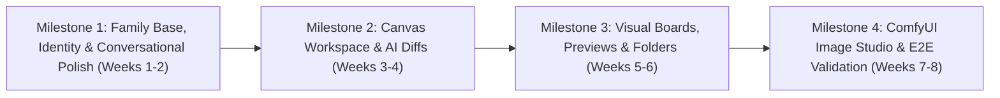

# Ezity AI — Phased Implementation Roadmap & Execution Plan

**Document Version:** 1.1.0  
**Date:** November 9, 2026  
**Status:** Approved Implementation Roadmap  
**Target Platform:** Ezity AI Family Platform (`EzityChat` base)  
**Execution Scope:** Non-destructive integration plan. No production code modified during assessment.  
**Working Directory:** `/Volumes/En.Sol-SSD/WebProject`

---

## 1. Executive Roadmap Summary

This roadmap translates the approved family integration architecture into **four sequential engineering milestones** totaling **6 to 8 person-weeks** (28 to 36 engineering days) of methodical implementation:

| Milestone | Core Deliverable | Target Capabilities & Hermes Ported Assets | Duration |
| :--- | :--- | :--- | :---: |
| **Milestone 1** | **Family Base, Identity & Conversational Polish** | Minimal 3-container topology, invite-only auth, Ezity Soul, LibreChat native theme adaptation, Quick Reply Chips, Thinking Accordion, Voice Dictation, Slash Menu. | **2 Weeks** |
| **Milestone 2** | **Canvas Workspace & AI Diffs** | Mongoose schemas, split-pane CodeMirror 6 Canvas (desktop) / slide-over sheet (mobile), side-by-side AI diffs, Humanized Activity Timeline. | **2 Weeks** |
| **Milestone 3** | **Canvas Boards, Previews & Folders** | Visual mindmap editor, in-browser PDF/Word/Excel previewers, Chat Files Drawer, Projects/Folder organization, Chat Export sheet. | **2 Weeks** |
| **Milestone 4** | **ComfyUI Image Studio & Platform Hardening** | Local ComfyUI Qwen-Image 2.1 tool, mask edit gallery, full IDOR/SSRF security audit, automated daily backup cron runbook. | **1.5 – 2 Weeks** |

---

## 2. Milestone 1: Family Platform Baseline, Identity & Conversational Polish (Weeks 1–2)

### Objectives
Establish the secure, private multi-user container baseline, enforce closed family account management, inject the Ezity companion persona, adapt to LibreChat's native design tokens (avoiding iOS skin mismatches), and port high-value conversational UX helpers (Quick Reply Chips, Thinking Accordion, Voice Input, Slash Commands).

### Task Breakdown
- [x] **Task 1.1: Minimal Docker Compose Tailoring**
  - Adjust `docker-compose.yml` to run only `api`, `mongodb`, and `ingress` (Caddy).
  - Disable optional resource-heavy services (`SEARCH=false`, omit `rag_api` and `vectordb`).
  - Configure `.env` with a secure random `CREDS_KEY` and `CREDS_IV` (64-character hex string).
- [x] **Task 1.2: Closed Family Authentication Configuration**
  - Set `ALLOW_REGISTRATION=false` in `.env`.
  - Configure admin invitation scripts (`config/invite-user.js`).
  - Verify local password hashing (bcrypt) and session cookie settings (`COOKIE_SECURE=true`, `SameSite=Lax`).
- [x] **Task 1.3: Centralized Ezity AI Persona & Branding Injection**
  - Create `config/ezity-soul.js` with `EZITY_SOUL_CORE`.
  - Configure `librechat.yaml` with default model specifications and inject Ezity companion instructions.
  - Replace default branding strings and vector logo with [`src/components/EzityLogo.tsx`](file:///Volumes/En.Sol-SSD/WebProject/hermes-mobile/src/components/EzityLogo.tsx).
- [x] **Task 1.4: Mobile Viewport Ergonomics (LibreChat Native Theme)**
  - Use LibreChat's native semantic tokens (`bg-surface-primary`, `text-text-primary`, `border-border-medium`) rather than an artificial iOS skin.
  - Add safe-area padding (`pb-[env(safe-area-inset-bottom)]`) to the chat composer to prevent home-indicator collision.
  - Port [`use-virtual-keyboard.ts`](file:///Volumes/En.Sol-SSD/WebProject/hermes-mobile/src/hooks/use-virtual-keyboard.ts) to smoothly dock the composer above the mobile keyboard.
- [x] **Task 1.5: Quick Reply Chips & Interactive Question Cards**
  - Port [`QuickReplyChips.tsx`](file:///Volumes/En.Sol-SSD/WebProject/hermes-mobile/src/components/QuickReplyChips.tsx), [`InteractiveQuestionCard.tsx`](file:///Volumes/En.Sol-SSD/WebProject/hermes-mobile/src/components/InteractiveQuestionCard.tsx), and [`quick-options-parser.ts`](file:///Volumes/En.Sol-SSD/WebProject/hermes-mobile/src/utils/quick-options-parser.ts).
  - Mount chips below assistant chat turns when the model outputs multiple-choice options or suggested next steps for effortless one-tap replies on mobile.
- [x] **Task 1.6: Universal Thinking & Reasoning Accordion**
  - Port [`ChatThinkingAccordion.tsx`](file:///Volumes/En.Sol-SSD/WebProject/hermes-mobile/src/components/ChatThinkingAccordion.tsx).
  - Automatically parse `<think>`, `<thought>`, and `<reasoning>` blocks from DeepSeek R1 and OpenAI o-series models, collapsing them into a clean collapsible accordion with an elapsed timer.
- [x] **Task 1.7: Slash Command Menu & Voice Input Button**
  - Port [`SlashCommandMenu.tsx`](file:///Volumes/En.Sol-SSD/WebProject/hermes-mobile/src/components/SlashCommandMenu.tsx) to provide instant shortcuts (`/canvas`, `/image`, `/search`, `/mindmap`) upon typing `/`.
  - Port [`VoiceInputButton.tsx`](file:///Volumes/En.Sol-SSD/WebProject/hermes-mobile/src/components/VoiceInputButton.tsx) utilizing browser Web Speech API for hands-free voice dictation.

### Milestone 1 Acceptance Gate (GO / NO-GO)
- **Gate Criteria:**
  1. The platform boots via `docker compose up -d` in < 20 seconds, consuming **< 600 MB RAM total**.
  2. Public sign-up is blocked; admin can generate an invite link to onboard a family member account.
  3. Assistant leads with the Ezity companion voice without robotic pleasantries.
  4. Models outputting options show interactive, tappable Quick Reply Chips.
  5. DeepSeek / reasoning models render thinking tokens inside a clean, collapsible accordion.
  6. Typing `/` displays the quick slash menu, and voice dictation populates the input field.

---

## 3. Milestone 2: Canvas Workspace, AI Diff Engine & Activity Timeline (Weeks 3–4)

### Objectives
Mount the CodeMirror 6 Canvas workspace into LibreChat's split panel, persist documents to MongoDB, enable non-destructive AI patch proposals with side-by-side diff review, and render humanized progress cards for tool executions.

### Task Breakdown
- [x] **Task 2.1: Canvas Mongoose Schemas & Migrations**
  - Implement `CanvasDocument`, `CanvasRevision`, and `CanvasCandidate` schemas in `packages/data-schemas/src/schema/`.
  - Enforce user-scoping index: `{ userId: 1, conversationId: 1 }`.
- [x] **Task 2.2: Canvas REST API Handlers**
  - Create `api/server/routes/canvas.js` and `api/server/services/Canvas/canvasService.js` (adapted from `hermes-mobile/src/service/canvas-service.ts`).
  - Implement document creation, manual editing, revision listing, and restore endpoints.
  - Implement proposal resolution endpoints: `/candidates/:id/accept` and `/candidates/:id/reject`.
- [x] **Task 2.3: Canvas SidePanel & Mobile Sheet Mounting**
  - Mount [`CanvasWorkspace.tsx`](file:///Volumes/En.Sol-SSD/WebProject/hermes-mobile/src/components/canvas/CanvasWorkspace.tsx) inside LibreChat's resizable split panel (`SidePanelGroup.tsx`).
  - On mobile (< 768px), render Canvas as an overlay slide-up sheet with a top grab handle rather than a cramped split pane.
  - Port CodeMirror 6 editor components: `CanvasCodeEditor.tsx`, `CanvasToolbar.tsx`, `CanvasHeader.tsx`.
- [x] **Task 2.4: AI Tool Registration & Diff Review UI**
  - Register `create_canvas_document`, `read_canvas_document`, and `propose_canvas_edit` tools.
  - Port [`CanvasDiffView.tsx`](file:///Volumes/En.Sol-SSD/WebProject/hermes-mobile/src/components/canvas/CanvasDiffView.tsx) to render side-by-side diffs when a proposal is pending.
  - Wire accept/reject buttons to trigger atomic document revision updates.
- [x] **Task 2.5: Humanized Activity Timeline**
  - Port [`ChatActivityTimeline.tsx`](file:///Volumes/En.Sol-SSD/WebProject/hermes-mobile/src/components/ChatActivityTimeline.tsx) and [`activity-aggregator.ts`](file:///Volumes/En.Sol-SSD/WebProject/hermes-mobile/src/utils/activity-aggregator.ts).
  - Transform raw JSON tool calls into friendly, readable progress cards (*"Searching the web for recipes..."*, *"Editing Canvas: Project Outline..."*).

### Milestone 2 Acceptance Gate (GO / NO-GO)
- **Gate Criteria:**
  1. User asks the model to draft a 50-line script; model invokes `create_canvas_document`; Canvas split-panel (or mobile sheet) opens showing formatted code.
  2. User asks to modify the script; model invokes `propose_canvas_edit`; UI renders a side-by-side diff highlighting additions (green) and deletions (red).
  3. Clicking **Accept** updates the document and creates a new revision in MongoDB; clicking **Reject** preserves the original document unchanged.
  4. Tool executions display natural human-readable activity cards instead of technical JSON.
  5. Logging in as User B confirms User B **cannot view or query** User A's Canvas documents.

---

## 4. Milestone 3: Canvas Boards, In-Browser Previews & Folder Organization (Weeks 5–6)

### Objectives
Enable visual mindmap generation, integrate in-browser rendering for attached PDF, Word, and Excel files, provide conversation folder organization, and support one-tap chat exports.

### Task Breakdown
- [x] **Task 3.1: Canvas Boards Mongoose Schemas & Service**
  - Implement `CanvasBoard`, `CanvasBoardRevision`, and `CanvasBoardCandidate` schemas.
  - Port `visual-board-service.ts` into `api/server/services/Canvas/visualBoardService.js`.
  - Register `create_mindmap_board`, `read_visual_board`, and `propose_board_edit` AI tools.
- [x] **Task 3.2: Visual Mindmap Editor Mounting**
  - Port [`VisualBoardEditor.tsx`](file:///Volumes/En.Sol-SSD/WebProject/hermes-mobile/src/components/canvas/VisualBoardEditor.tsx) and [`mindmap-layout.ts`](file:///Volumes/En.Sol-SSD/WebProject/hermes-mobile/src/lib/mindmap-layout.ts).
  - Add mode toggle in Canvas Header: **[Document Mode] | [Visual Board Mode]**.
  - Verify node dragging, pan/zoom, edge relationship rendering, and hierarchical tree layout.
- [x] **Task 3.3: Native In-Browser Document Previewers**
  - Install dependencies: `react-pdf`, `pdfjs-dist`, `docx-preview`, `exceljs`, `jszip`.
  - Port [`PdfPreview.tsx`](file:///Volumes/En.Sol-SSD/WebProject/hermes-mobile/src/components/PdfPreview.tsx), [`DocxPreview.tsx`](file:///Volumes/En.Sol-SSD/WebProject/hermes-mobile/src/components/DocxPreview.tsx), and [`XlsxPreview.tsx`](file:///Volumes/En.Sol-SSD/WebProject/hermes-mobile/src/components/XlsxPreview.tsx).
  - Mount previewers inside a responsive modal triggered when clicking file attachment chips in chat.
- [x] **Task 3.4: Chat Files Drawer & One-Tap Exporter**
  - Port [`ChatFilesDrawer.tsx`](file:///Volumes/En.Sol-SSD/WebProject/hermes-mobile/src/components/ChatFilesDrawer.tsx) allowing users to inspect all files, images, and documents generated in the current conversation.
  - Port [`ChatExportSheet.tsx`](file:///Volumes/En.Sol-SSD/WebProject/hermes-mobile/src/components/ChatExportSheet.tsx) to export any conversation to Markdown, JSON, or text with one tap.
- [x] **Task 3.5: Projects & Folder Hierarchy**
  - Port [`ProjectsView.tsx`](file:///Volumes/En.Sol-SSD/WebProject/hermes-mobile/src/components/ProjectsView.tsx) to allow family members to group conversations into named folders (*"School"*, *"Vacation"*, *"Cooking"*, *"Coding"*).

### Milestone 3 Acceptance Gate (GO / NO-GO)
- **Gate Criteria:**
  1. User asks: "Create a mindmap of our family vacation plan"; model invokes `create_mindmap_board`; interactive tree renders with styled branch nodes and zoom controls.
  2. User uploads a `.docx`, `.xlsx`, or `.pdf` file; clicking the preview icon renders the document inside the browser with tables and formatting intact, without downloading.
  3. Chat Files Drawer shows all attachments and artifacts in the chat.
  4. Conversations can be organized into project folders and exported cleanly to Markdown.
  5. Document preview verifies that files uploaded by User A return `403 Forbidden` if accessed via direct URL by User B.

---

## 5. Milestone 4: ComfyUI Image Studio & Full Platform Hardening (Weeks 7–8)

### Objectives
Integrate local ComfyUI image generation with prompt optimization, verify multi-user isolation across all boundaries, and deploy the automated backup runbook.

### Task Breakdown
- [x] **Task 4.1: ComfyUI Integration Tool**
  - Port `gateway-image-client.ts` and `vision-optimizer.ts` into `api/server/services/Tools/comfyImageClient.js`.
  - Expose `generate_image` and `edit_image` tools to models.
  - Implement WebSocket step-progress listener and error normalization.
- [x] **Task 4.2: Output Storage & Gallery UI**
  - Save generated PNGs to `uploads/${userId}/images/${fileId}.png`.
  - Port [`RunGeneratedImages.tsx`](file:///Volumes/En.Sol-SSD/WebProject/hermes-mobile/src/components/RunGeneratedImages.tsx) to render image cards in chat turns with download, zoom, and mask editing controls.
- [x] **Task 4.3: End-to-End Multi-User Security Audit**
  - Execute automated IDOR test suite: User A attempts to read User B's chats, Canvas documents, visual boards, memories, and images via API.
  - Verify that SSRF blocking rules strictly reject `http://169.254.169.254/` and `http://192.168.1.1/` in custom provider endpoints.
- [x] **Task 4.4: Backup Script & Host Runbook Deployment**
  - Deploy automated daily backup script to cron (dumping MongoDB and archiving `uploads/`).
  - Perform test disaster recovery on a secondary machine; verify full restoration in under 10 minutes.

### Milestone 4 Acceptance Gate (Final Platform Acceptance)
- **Final Acceptance Criteria:**
  1. **All Core Pillars Operational:** Canvas Workspace with diffs, Visual Boards, ComfyUI image studio, In-Browser Document Previewers, Quick Reply Chips, and Ezity Soul are fully functional.
  2. **Zero Cross-User Leakage:** Automated security tests confirm 100% tenant isolation across all endpoints.
  3. **Visual Cohesion:** The entire interface adheres to LibreChat's native design tokens in both dark and light modes.
  4. **Resource Stability:** The entire system runs continuously under 1.2 GB RAM idle, scaling smoothly during active family chat turns.
  5. **Backup Verified:** Automated backup runs nightly with verified restore capability.

---

## 6. Critical Risks, Failure Modes & Mitigations

| Identified Risk | Likelihood | Impact | Concrete Mitigation |
| :--- | :---: | :---: | :--- |
| **Upstream LibreChat Rebase Conflicts** | Low-Med | Medium | Strict modularity: Custom Canvas components live in dedicated directories (`client/src/components/Canvas/`); styling uses LibreChat's native design tokens; branding is injected via `librechat.yaml` rather than editing core transport files. |
| **CodeMirror 6 Packaging in Vite** | Low | Low | CodeMirror 6 uses standard ES modules and standard React wrappers, with zero peer dependency conflicts with React 18 or Vite. |
| **ComfyUI GPU VRAM Contention** | Medium | Medium | Implement queue bounding in `comfyImageClient.js` (max 1 concurrent generation job). If VRAM is full, jobs queue gracefully rather than crashing the graphics driver. |
| **Family Member Account Accidental Data Deletion** | Low | High | Deletions require explicit confirmation modals; daily automated MongoDB backups retain 14 days of point-in-time snapshots for instant rollback. |

---

## 7. Resource & Effort Summary

- **Total Implementation Effort:** **28 to 36 Engineering Days** (~6 to 8 calendar weeks).
- **Assumed Staffing:** 1 Senior Full-Stack Engineer working methodically.
- **Immediate Next Step:** Upon project owner approval, execute **Milestone 1, Task 1.1** (configuring the minimal family `docker-compose.yml`, verifying invite-only authentication, and injecting Ezity Soul with Quick Reply Chips).
